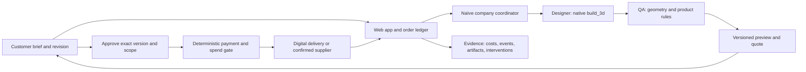

# Weekend implementation plan

This is an implementation-ready proposal, not a built or deployed application. Research was checked November 7, 2026; no SDK sessions, payments, or supplier orders were executed for this planning work. Start from [the company offer](company-plan.md) and [verified SDK notes](research/naive-sdk.md).

## Finish line at Sunday 11am

One real customer can request a supported branded desk display, answer a clarification, review actual CAD and its dimensions, request a revision, approve the exact version and scoped quote, and receive the agreed digital package after verified payment if payment is enabled. The agent company runs that loop with persisted records, visible costs, and honest human-intervention logs. Physical production is an optional confirmed branch with supplier acknowledgment; a prepared handoff is not an order.

If checkout is unavailable, show unpaid or test payment explicitly and deliver a clearly labeled free pilot. Never turn a test webhook into revenue. If printer access is unavailable, the digital package is the advertised deliverable and validation must test willingness to buy that deliverable.

## Fastest stack and integration choice

- One TypeScript/ESM web app with server-side routes and `@usenaive-sdk/managed-agents`; choose the framework the team already knows. No separate Python orchestration service.
- Naïve native `build_3d` using **build123d** for the first dimensional CAD product. Use editable parameterized source, not appearance-only generated meshes. First call can install the toolchain; test it immediately.
- Durable SQL orders/events/artifacts. SQLite is enough for a single persistent local instance; use shared hosted Postgres for a multi-instance/public deployment. Do not run a serverless production order ledger on ephemeral local disk.
- Persist published Naïve file IDs plus order ownership. Serve customer downloads through an authorization check or unguessable scoped link; org-scoped files do not create customer isolation by themselves.
- One status page rather than a large company dashboard. One customer conversation channel, initially an in-app thread. Email is useful only after inbox/account setup is verified.
- First fulfillment route: digital delivery. Parallel human task: verify a specific local printer/provider. Add one physical route only if access, turnaround and spend authority are concrete.

CadQuery/OpenSCAD are fallback options if the native CAD spike fails; do not run a second geometry stack just because it appeared in research. Naïve remains the actual company runtime even with a fallback renderer.

## First integration spike — timebox 45 minutes

The preserved [hackathon rules](../hackathon-rules.md) note unresolved submission format and prebuilt-code permissibility; confirm relevant organizer requirements at kickoff. The transcription and plan are preparation, not a claim about eligible prior implementation.

1. Obtain organizer-provided Naïve access; verify organization, active plan/credits, model list and tools. Keep credentials server-side and out of Git.
2. Create one low-budget designer agent and run a real SDK session. Capture session ID and events.
3. Ask it to build a simple dimensioned QR-display base using `build_3d`, export STEP/STL, and publish previews.
4. Download the real outputs, inspect geometry results, and visually open the preview. Confirm units and actual dimensions.
5. Restart the app and recover the session/job record.

**Pass:** actual tool result, downloadable nonempty files, sensible dimensions, saved provenance. **Fail:** ask a Naïve mentor to fix platform access/tool availability, while the other builder continues intake/spec work. If native CAD is unavailable, use one locally verified template/export path through a narrow agent tool. Keep the failed check visible; no placeholder CAD success.

## Architecture

Baseline orchestration is app-owned sequential Naïve SDK sessions with persisted outputs and idempotent stage claims. Official sources conflict on native teams being shipped versus coming soon; use the native company board only after an authenticated create/delegate-or-assign/result test succeeds. The application owns the customer order state; the board owns agent work. Choose one dispatcher per stage, so the app and coordinator cannot both launch duplicate design/fulfillment jobs.

## Minimum data contract

| Record | Required fields |
|---|---|
| Customer/job | ID, owner/access token hash, contact consent, original brief, supported family, dimensions in mm, quantity, deadline, authorized logo reference |
| Design version | Job ID, revision number, normalized specification, source/file hashes, STEP/STL/preview IDs, generation session ID, actual check results |
| Quote | Job/version ID, digital vs physical scope, currency, amount, cost basis, supplier reference if any, expiry, included revisions, delivery conditions |
| Approval | Exact design version and quote ID, timestamp, customer decision; invalidated on relevant change |
| Payment | Provider ID, live/test mode, verified status, amount/currency, quote ID, idempotency key; no raw card data |
| Fulfillment | Digital package ID or supplier ID/order acknowledgment, authorized amount, state, last provider response, retry key |
| Event/intervention | Event ID, job/session ID, timestamp, actor, action, evidence reference, cost, exception and human reason |

Store generated artifacts immutably. A revised file must never overwrite the bytes the customer previously approved.

## Order state and narrow tools

Core path: `received → needs_details → designing → qa → quoted → awaiting_approval → awaiting_payment → ready_to_deliver → delivered`.

`needs_details` can be skipped for complete briefs. Failed QA goes to a bounded redesign attempt, then `needs_human` with a reason after two repairs. Customer revision creates a new design version and returns to design; old approval/quote cannot authorize the new one. Physical branch: `ready_to_submit → submission_unknown/submitted → acknowledged → in_production → shipped/collected → delivered`. Also support `cancelled`, `expired_quote`, `payment_failed` and `supplier_blocked`.

Proposed application tools (these are **our tool names**, not claimed Naïve APIs): `read_job`, `request_details`, `save_design`, `record_qa`, `create_quote`, `request_approval`, `deliver_package`, `submit_supplier_order`, `record_exception`. Validate arguments and allowed transitions in server code. The agent may propose a quote but the rate card/cost calculation must be deterministic.

## Reliability and customer-visible states

- **Missing dimensions/logo:** ask a focused question; offer a preset or text-only branding. Avoid inaccessible or unsafe customer-supplied URL fetches; accept bounded uploads and treat asset text as data.
- **Generating:** show real progress and a recoverable job ID. A tab refresh must not create a second paid session.
- **Invalid CAD:** show the failed check and bounded retry. Never display a stale preview as the approved version of a new file.
- **QA:** valid/watertight, dimensions, minimum template thickness and footprint. Slicer checks need a real printer profile. Physical fit, strength, finish, QR usability and stability remain unverified until tested on the actual output.
- **Customer change:** invalidate version-bound approval and affected quote; regenerate, recheck and ask for a new decision.
- **Payment:** signed provider callback, amount/currency matching and deduplication. Client-side “success” is not authority to fulfill.
- **Supplier timeout:** mark `submission_unknown` and reconcile by reference before retrying; no duplicate paid order. A rejected supplier order stays blocked and offers a truthful alternative.
- **Budget exhausted:** pause and explain; keep artifacts and customer state. Platform inference caps are separate from fabrication spend caps.
- **Empty operations view:** say no requests yet and offer the intake link. No seeded fake sales or agent activity.
- **Authorization:** server checks customer ownership for files, approvals and quotes. URLs/tokens for one job must not expose another.

## Cancellation, refunds and failed production

Publish the exact delivery scope, included revision and cancellation terms before accepting payment; customer consent and payment records must reference that policy version. This is a proposed operational policy for the team to configure, not a claim that checkout or refunds are connected.

- Before payment, cancellation closes the job and cancels pending work. Expired quotes cannot be charged.
- Before a paid digital job starts, allow cancellation into `refund_pending`; issue the agreed full refund only through a verified provider flow. Once work or download delivery has started, follow the disclosed accepted policy and escalate disputes rather than let an agent invent a denial.
- If the company cannot deliver the agreed paid package, offer a corrected package within the agreed window or a refund path. After an included revision, additional work requires a new accepted quote; don't silently consume the customer's budget.
- If a supplier rejects or misses the agreed pre-submission availability check, set `supplier_blocked`, stop purchases, notify the customer, and offer an explicitly approved alternative or refund. If a supplier may already have accepted an ambiguous submission, reconcile first; cancellation is not assumed successful.
- After production begins, confirm actual supplier cancellation/rework terms before promising a refund or a free reprint. Record failure evidence, proposed remedy, liability/cost allocation and customer choice. Human exception handling counts as intervention.
- Persist refund/reprint operations with original payment/order reference, amount/currency, status and a stable idempotency key. Enforce each new refund <= amount collected minus confirmed prior refunds; cumulative confirmed refunds must never exceed the amount collected. Verified provider results update `refunded`/`partially_refunded` or keep `refund_failed`; never show money as returned because the agent requested it.

Add acceptance cases for cancellation before payment, supplier rejection after payment, duplicate refund callback and partial refund limits when those integrations are enabled. A weekend pilot may use a manual refund path with explicit ownership instead of claiming automated support.

## Two-person schedule (suggested ownership)

Srujan owns customer experience, intake, approvals and real customer discovery. Zain owns Naïve integration, native CAD, QA and order events. Both pair on one shared API/data contract first. One person owns credentials, deployment and migrations at a time.

| Time, Pacific | Srujan | Zain | Observable gate |
|---|---|---|---|
| Sat 13:00–14:00 | Interview first opt-in customer; define offer; verify printer lead | Naïve/CAD spike | Real brief and real exported object |
| 14:00–16:00 | Intake, customer status, logo/text input | Constrained template, export and persistent job | Request produces viewable/downloadable files |
| 16:00–18:30 | Versioned approval/revision UI, quote display | QA, retry bounds, agent handoffs, cost events | Revision invalidates old approval |
| 18:30–20:30 | First customer test; checkout or labeled pilot path | Delivery package, verified callbacks, deduplication | First agreed delivery end to end |
| 20:30–23:00 | Two more opt-in briefs; improve usability | One confirmed physical handoff if feasible; recovery tests | Evidence of actual outcomes, exceptions visible |
| 23:00–01:00 | Inspect customer journey and evidence, cut unused UI | Restart/retry/ownership/spend tests | Stable vertical slice |
| 01:00–07:00 | Protected rest; only bounded scheduled work | Protected rest; only bounded scheduled work | No open-ended agent spending loops |
| Sun 07:00–09:00 | Verify feedback, real use and physical status | Repair material failures, final integrated checks | Customer output and truthful ledger |
| 09:00–10:00 | Rehearse pitch and actual evidence | Independent cross-check of live claims | Demo works with known latency |
| 10:00–10:30 | Capture fallback recording and customer proof | Freeze deployment; verify public URL if deployed | Live journey and labeled backup |
| 10:30–11:00 | Buffer and organizer-confirmed submission | Buffer and organizer-confirmed submission | Hacking stops at 11am |

This allocates rest within the event, not 22 hours of uninterrupted work per person. If starting late, compress by cutting supplier automation, email, second templates and optional mobile work; preserve the core delivery loop and verification.

## Acceptance checklist to carry into implementation

| Requirement | Evidence needed |
|---|---|
| Mandatory SDK is real | SDK-created agent/session IDs and actual tool events |
| One supported product | Normalized spec, real CAD source/exports, opened preview |
| Clear customer flow | Complete brief and incomplete brief both reach the right next step |
| Version integrity | Revision changes file/version; old approval cannot fulfill it |
| Useful QA | Deliberately invalid dimensions fail; passing checks have actual tool output |
| Quote truth | Scope, expiry, cost basis and estimated/confirmed labels |
| Payment truth | Verified callback, amount/currency match, visible test/live mode |
| Retry/restart | No duplicate session/purchase on refresh, callback replay or process restart |
| Spend limits | Unauthorized/over-limit purchase refused with a saved reason |
| Customer isolation | Another job's token cannot retrieve or approve artifacts |
| Delivery | Complete accessible package; physical handoff only with real acknowledgment |
| Autonomous operations | Decisions, bounded follow-up/status task, costs and human interventions recorded |
| Demo honesty | Counts reconcile with underlying records; backup is labeled recorded |
| Public deployment, if chosen | Actual deployed URL tested with intended access and mobile viewport |

No implementation checks have passed yet; this table defines the next build's finish line. The repository verification script checks planning and transcription artifacts, not these future product behaviors.
